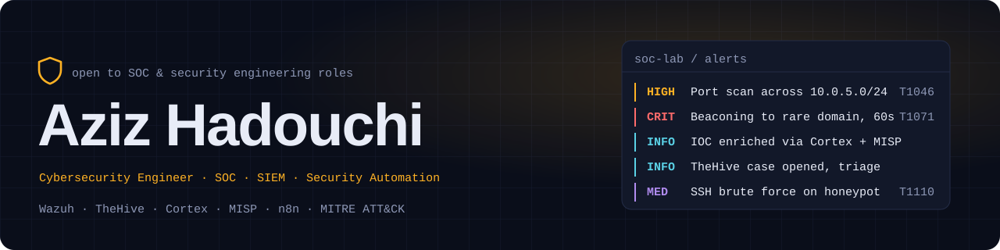

<picture>
  <source media="(prefers-color-scheme: dark)" srcset="assets/banner-dark.svg">
  <source media="(prefers-color-scheme: light)" srcset="assets/banner-light.svg">
  
</picture>

<p>
  <a href="https://aziz-hadouchi.vercel.app"><b>Portfolio</b></a> ·
  <a href="https://www.linkedin.com/in/aziz-hadouchi/"><b>LinkedIn</b></a> ·
  Tunis, Tunisia
</p>

I build the systems that catch attackers: SIEM pipelines, SOAR playbooks and honeypots that turn raw logs into detections, and detections into closed cases.

Cybersecurity engineering student at **ESPRIT** (graduating 2026). Before security I spent years shipping web and mobile apps, so I automate the repetitive parts of SOC work instead of clicking through them.

### Security work

| Project | What it does | Stack |
| --- | --- | --- |
| **SOC Security Operations Lab** | Ingests Windows and identity telemetry, raises alerts, enriches them and runs the case end to end | Wazuh · TheHive · Cortex · MISP · n8n |
| **Honeypot-LLM** | SSH honeypot that detects brute force, malware uploads and privilege escalation, with LLM enrichment of every alert | Python · Paramiko · Flask · n8n · Ollama |
| **AI Honeypot Deception System** | Keeps attackers engaged with decoy credentials and artifacts, and records full sessions for threat intel | LLM · Python |
| **PCAP Threat Analysis Pipeline** | Finds scanning, C2 and exfiltration in packet captures and maps each finding to MITRE ATT&CK | Python · PCAP |
| **YARA Monitor** | Scans files against community YARA rules from a web UI or the CLI, built for malware analysis labs | YARA · Python |
| [**SOC ML Recommendation Engine**](https://github.com/000H2G000/soc-ml-recommendation-engine) | Compliance-aware response recommendations for healthcare SOC analysts | Wazuh · Gemini · HIPAA / NIST |

Most of these live in private repos. I'm happy to walk through the code or demo them in an interview.

### Experience

**Security Intern, Sofitel** (2025): deployed Wazuh SIEM, ran a honeypot to study attacker TTPs, integrated TheHive and Cortex for automated incident response, and automated SOC alerting with n8n.

Earlier: full-stack and mobile development at **I-WAY**, **Orange Digital Center** and **CareDify**, and a DevSecOps-built event platform for the **Tunisian Fencing Federation**.

### Toolbox

```text
detect    Wazuh · TheHive · Cortex · MISP · YARA · MITRE ATT&CK
automate  n8n · Python · Docker · LLM pipelines (Ollama, Gemini)
systems   Linux hardening · Windows · networking · virtualization
build     TypeScript · React · React Native · Node.js · MongoDB
```

<sub>Open to SOC analyst and security engineering roles. Reach me through LinkedIn or the contact section of my portfolio.</sub>
